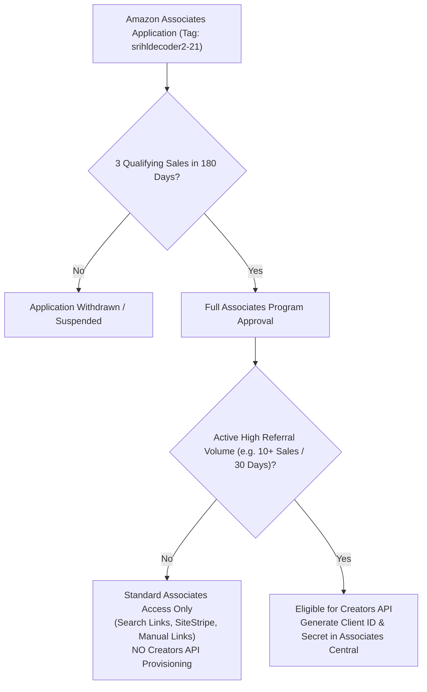

# PHASE 59C.1 — AMAZON CREATORS API FEASIBILITY & PA-API DEPRECATION REPORT

**Repository**: `gel2701/stihl-decoder`
**Phase**: 59C.1 — Active Evidence Recovery & Creators API Correction
**Authoritative Date**: 2026-11-01
**Affiliate Associate Tag**: `srihldecoder2-21`
**Status**: ACTIVE EVIDENCE RECOVERY REPORT

---

## 1. Executive Summary & Critical API Transition

> [!WARNING] PA-API 5.0 DEPRECATION NOTICE
> **Amazon Product Advertising API (PA-API 5.0)** was officially deprecated and its endpoints retired on **May 15, 2026**.
> The legacy AWS Signature Version 4 (SigV4) authentication mechanism has been discontinued. All programmatic catalog integrations for affiliates, creators, and publishers must use the **Amazon Creators API**.

This feasibility audit evaluates the **Amazon Creators API** against StihlDecoder's canonical catalog (18,373 parts) and establishes:
1. The technical structure, authentication protocols, and endpoints of the Amazon Creators API.
2. The exact qualification milestones distinguishing standard Amazon Associates approval from Creators API credential eligibility.
3. How to verify and reconstruct ASIN identities safely without violating anti-scraping rules or compromising user trust.

---

## 2. Amazon Creators API Architecture & Documentation

Based on the official Amazon Associates Creators API specifications (`affiliate-program.amazon.com/creatorsapi/docs`):

### A. Base Endpoints & Protocol
- **Catalog Base Endpoint**: `https://creatorsapi.amazon/catalog/v1/` (with localized routing)
- **Protocol**: Standard HTTPS REST with JSON payloads.
- **Required HTTP Headers**:
  - `Authorization: Bearer <access_token>`
  - `x-marketplace: <domain>` (e.g., `www.amazon.nl`, `www.amazon.de`, `www.amazon.com`)
  - `Content-Type: application/json`

### B. OAuth 2.0 Authentication
- Unlike PA-API 5.0's SigV4 signing, the Creators API authenticates via **OAuth 2.0 Client Credentials Grant** using **Login with Amazon (LwA)**.
- Partners exchange their **Credential ID (Client ID)** and **Client Secret** against the LwA token endpoint (`https://api.amazon.com/auth/o2/token`).
- Generated bearer tokens have a time-to-live (TTL) of **3,600 seconds (1 hour)**.

### C. Available Operations
| Operation | Input Parameters | High-Level Resources | Catalog Coverage / Capabilities |
| :--- | :--- | :--- | :--- |
| **`SearchItems`** | `keywords`, `brand`, `title`, `partnerTag`, `marketplace` | `ItemInfo`, `OffersV2`, `Images`, `BrowseNodeInfo` | Returns up to 10 matching products per call. Filters by keyword or category. |
| **`GetItems`** | `itemIds` (array of up to 10 ASINs), `itemIdType: "ASIN"`, `partnerTag` | `ItemInfo`, `OffersV2`, `Images` | Looks up detailed attributes, current price, availability, and images for known ASINs. |
| **`GetVariations`** | `asin`, `partnerTag` | `VariationSummary`, `ItemInfo` | Retrieves size/color/pack variations of parent ASINs. |
| **`GetBrowseNodes`** | `browseNodeIds`, `partnerTag` | `BrowseNodes` | Retrieves catalog taxonomy and category tree hierarchies. |

---

## 3. Access Requirements & StihlDecoder Eligibility Status

Amazon imposes a clear distinction between **Initial Associates Account Approval** and **Creators API Eligibility**:

### Status for Tag `srihldecoder2-21`:
- **Current Qualification**: StihlDecoder is currently in the initial referral phase.
- **Sales Threshold Met?**: **NO**. The account has not reached the sustained sales volume required to unlock API credential generation under *Tools > Creators API* in Associates Central.
- **Account Evidence**: There are zero active API keys or OAuth credentials provisioned for this project.
- **Conclusion**: The application cannot assume or claim Creators API access. Any implementation that relies on programmatic API calls is blocked until sales milestones are achieved.

---

## 4. Legitimate ASIN Discovery & Verification Without Scraping

Until Creators API credentials are unlocked, ASIN discovery and verification must proceed through legitimate, non-scraping channels:

1. **Amazon SiteStripe Manual Verification**: Associates Central's built-in SiteStripe tool allows human operators to look up products directly on Amazon, inspect the ASIN, verify seller legitimacy (e.g., "Dispatched from and sold by Amazon" or authorized dealers), and obtain authentic affiliate URLs.
2. **EAN/GTIN Cross-Referencing**: Manufacturers (Bosch, NGK, Oregon, Stens) publish universal GTINs/EANs. These barcodes provide a definitive bridge to identify corresponding Amazon catalog entries via public marketplace catalogs without web scraping.
3. **Primary Parts Documentation**: STIHL service manuals and quick reference guides establish the authoritative OEM part number, eliminating incorrect cross-references (such as mistaking a Kohler ignition coil for a STIHL fuel filter).

---

## 5. Prohibition on Scraping & Bot Bypasses

Section 4 of the Amazon Associates Operating Agreement explicitly forbids:
- Geotargeting evasion, proxy rotation, and automated bot scraping.
- Bypassing CAPTCHA challenges or HTTP 503 bot mitigation barriers.
- Storing or displaying outdated pricing or stock availability data.

In StihlDecoder, probe anchor `11231602050` confirmed that automated requests immediately encounter Amazon's bot protection challenge. Under project invariants, **no scraping workaround will ever be implemented**.

---

## 6. Recommended Interim Architecture (Phase 59B/59C.1 Compliant)

1. **100% Search Fallback URLs**: Maintain compliant, direct keyword search links (`https://www.amazon.nl/s?k=...&tag=srihldecoder2-21`) for all 18,373 catalog parts.
2. **Dual-Gate ASIN Promotion**: Strictly forbid direct ASIN links in `data/affiliate/amazon_part_offers.json` until both technical MPN cross-referencing and independent Amazon ASIN identity verification are established.
