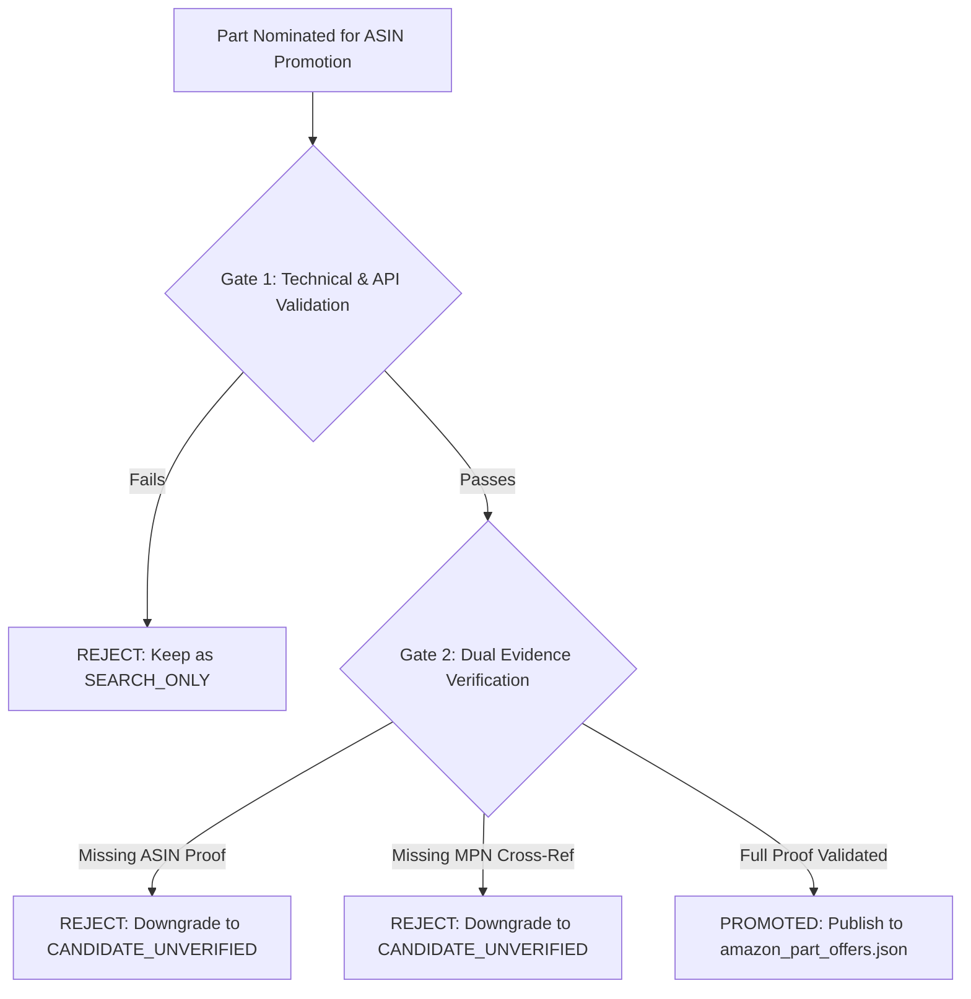

# PHASE 59C.1 — AMAZON MATCHING IMPLEMENTATION ROADMAP & TWO-GATE ARCHITECTURE

**Repository**: `gel2701/stihl-decoder`
**Phase**: 59C.1 — Active Evidence Recovery & Creators API Correction
**Target Milestone**: Phase 59D (Future Activation)
**Authoritative Date**: 2026-11-01

---

## 1. Core Principle: Evidence Before Publication

No direct ASIN offer will ever be added to `data/affiliate/amazon_part_offers.json` without satisfying both technical and independent evidence gates:

---

## 2. Gate 1 — Technical & API Validation

Before any ASIN is considered:
1. **ASIN Syntax & Length**: Must be exactly 10 alphanumeric characters.
2. **Marketplace Validation**: Must resolve to a supported regional Amazon marketplace (`amazon.nl`, `amazon.de`).
3. **Creators API Verification (When Provisioned)**:
   - Perform `GetItems` call with `itemIds: [ASIN]` using OAuth 2.0 Bearer token.
   - Verify that item returns `Availability: InStock` and valid `ItemInfo.Title`.
   - Verify brand and manufacturer fields match the expected supplier.

---

## 3. Gate 2 — Dual Evidence Verification

Before promotion, an audit record must prove BOTH:
1. **Factor A — Part Compatibility Proof**:
   - Official manufacturer cross-reference catalog or STIHL parts breakdown document identifier.
   - Exact OEM MPN and supersession history.
   - List of exact machine models confirmed compatible.
2. **Factor B — Amazon ASIN Identity Proof**:
   - Independent verification that the ASIN identifies the exact physical product intended.
   - Distinction between `GENUINE_STIHL`, `OEM_SUPPLIER_EQUIVALENT`, and `MANUFACTURER_AFTERMARKET`.
   - Explicit confirmation that the listing is NOT an unrelated variant (avoiding apparel or mismatched ASIN traps).

---

## 4. Interim Strategy Prior to Creators API Provisioning

Because tag `srihldecoder2-21` is in the qualification phase without Creators API keys:
1. Production runtime continues serving **100% compliant keyword search fallback URLs**.
2. All candidate ASINs remain strictly quarantined in audit files (`PHASE59C_VERIFIED_MATCHES.json`).
3. Runtime offers file `data/affiliate/amazon_part_offers.json` remains **strictly empty (`[]`)**.
