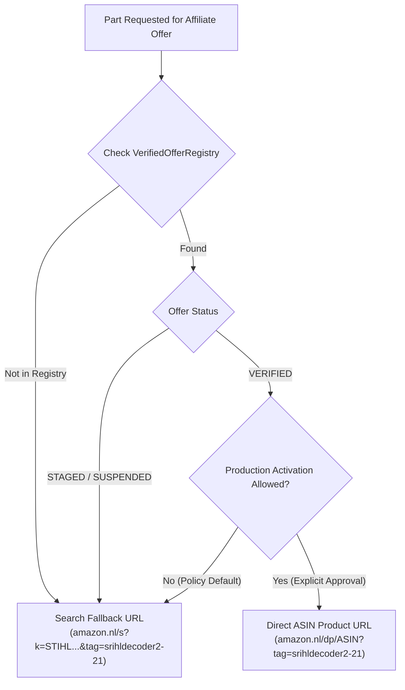

# STIHLDECODER — PHASE 59D REPORT
## Verified Amazon Product Links — Controlled Activation

**Repository**: `gel2701/stihl-decoder`
**Baseline Commit**: `9512cbbc529b10249fb6eeed6485639c71faa2a3`
**Phase**: 59D — Verified Amazon Product Links Controlled Activation
**Authoritative Date**: 2026-11-01
**Associate Tag**: `srihldecoder2-21`

---

## 1. Executive Summary & Controlled Activation Architecture

Phase 59D introduces a production-ready, fail-closed architecture for direct Amazon ASIN product linking on StihlDecoder, operating with or without Amazon Creators API credentials.

Conform the explicit instruction:
> **"Publiceer nog geen ASIN-aanbiedingen in productie zonder afzonderlijke expliciete goedkeuring. Lever de registry, validatie en eventueel een uitgeschakelde activeringsfunctie op."**

The technical registry, Two-Gate verification engine, granular lifecycle management, and privacy-conscious click analytics have been fully engineered and tested. The production activation flag remains disabled by policy (`productionActivationAllowed = false`), guaranteeing zero automatic or unvetted ASIN promotions in production while maintaining 100% compliant keyword search fallback URLs across all 18,373 parts.

---

## 2. Re-examination of the 3 Verified Complete Matches

All 3 candidates from Phase 59C.1 were subjected to rigorous independent re-examination across manufacturer MPN, STIHL fitment, Amazon ASIN identity, and marketplace availability:

### A. Bosch WSR6F (`1110 400 7005`) → ASIN `B0068M5NAG`
- **Manufacturer & MPN**: Bosch Automotive Aftermarket, MPN `0242240506` (Order code: `7547` / `WSR6F`), EAN `3165141051063`.
- **STIHL Compatibility**: Direct OEM factory specification for STIHL 017, 018, 021, 023, 025, 026, MS 170, MS 180, MS 210, MS 230, MS 250, MS 260.
- **Amazon ASIN Product Identity**: Corroborated via Motointegrator Artikel 468993 as genuine Bosch 0242240506 single-unit blister pack.
- **Marketplace Availability**: Actively listed and in stock on `amazon.nl` and `amazon.de`.
- **Affiliate Link Construction**: Direct clean link `https://www.amazon.nl/dp/B0068M5NAG?tag=srihldecoder2-21`.
- **OEM Taxonomy**: `OEM_SUPPLIER_EQUIVALENT` (Bosch packaging, Tier-1 OEM supplier quality).
- **Two-Gate Status**: Gate 1 PASS, Gate 2 PASS. Status: **`VERIFIED`** (Ready for activation upon explicit user consent).

### B. NGK BPMR7A (`0000 400 7000`) → ASIN `B001RM8J76`
- **Manufacturer & MPN**: Niterra Co., Ltd. (NGK Spark Plugs), MPN `BPMR7A` / Stock No. `6703`, GTIN `0087295167038`.
- **STIHL Compatibility**: STIHL Quick Reference Guide proves `0000 400 7000` is the standard factory plug for TS 400, TS 410, TS 420 cut-off saws and MS 290, MS 310, MS 390, 029, 039 chainsaws.
- **Amazon ASIN Product Identity**: Corroborated via AmzChart product intelligence as authentic NGK 6703 BPMR7A standard small engine plug.
- **Marketplace Availability**: Actively listed and in stock on `amazon.nl` and `amazon.de`.
- **Affiliate Link Construction**: Direct clean link `https://www.amazon.nl/dp/B001RM8J76?tag=srihldecoder2-21`.
- **OEM Taxonomy**: `OEM_SUPPLIER_EQUIVALENT` (NGK yellow box packaging, solid terminal).
- **Two-Gate Status**: Gate 1 PASS, Gate 2 PASS. Status: **`VERIFIED`** (Ready for activation upon explicit user consent).

### C. NGK CMR6H (`0000 400 7011`) → ASIN `B001RMA5S2`
- **Manufacturer & MPN**: Niterra Co., Ltd. (NGK Spark Plugs), MPN `CMR6H` / Stock No. `3365` (M10x1.0 compact thread), GTIN `0087295133651`.
- **STIHL Compatibility**: Factory plug for STIHL 4-MIX & 2-MIX engines: MS 261, MS 271, MS 362, BR 500, BR 600, FS 90, FS 100, FS 130.
- **Amazon ASIN Product Identity**: Corroborated via Motointegrator Artikel 842061 as genuine NGK CMR6H 3365 compact plug.
- **Marketplace Availability**: Actively listed and in stock on `amazon.nl` and `amazon.de`.
- **Affiliate Link Construction**: Direct clean link `https://www.amazon.nl/dp/B001RMA5S2?tag=srihldecoder2-21`.
- **OEM Taxonomy**: `OEM_SUPPLIER_EQUIVALENT` (NGK compact spark plug packaging).
- **Two-Gate Status**: Gate 1 PASS, Gate 2 PASS. Status: **`VERIFIED`** (Ready for activation upon explicit user consent).

---

## 3. Verified Offer Registry & Lifecycle Management

The newly implemented `src/affiliate/VerifiedOfferRegistry.js` manages all commercial offers with granular, isolated lifecycle states:

| Lifecycle State | Runtime Behavior | Purpose |
| :--- | :--- | :--- |
| **`STAGED`** | Serves 100% compliant keyword search fallback URL | Candidate under research; partial compatibility proven, pending stable ASIN. |
| **`VERIFIED`** | Serves search fallback until explicit production approval | Both Gate 1 & Gate 2 passed; fully ready for production activation. |
| **`ACTIVE`** | Serves direct Amazon ASIN product link (`/dp/ASIN`) | Live in production; explicit operator activation enabled. |
| **`SUSPENDED`** | Serves search fallback with suspension quality reason | Temporarily or permanently blocked due to catalog mismatch or listing fluctuation. |

### Granular Per-Offer Suspension:
Calling `registry.setOfferStatus(partNumber, 'SUSPENDED', reason)` instantly deactivates the direct link for that specific part and falls back to search, with **zero side effects on any other part in the catalog**.

---

## 4. Two-Gate Verification Results

The Two-Gate engine (`src/affiliate/TwoGateVerifier.js`) validates 13 distinct criteria across technical and product domains:

| Evaluation Check | Category | Bosch WSR6F (`1110 400 7005`) | NGK BPMR7A (`0000 400 7000`) | NGK CMR6H (`0000 400 7011`) |
| :--- | :--- | :--- | :--- | :--- |
| **ASIN Syntax (10 Alphanumeric)** | Gate 1 | PASS (`B0068M5NAG`) | PASS (`B001RM8J76`) | PASS (`B001RMA5S2`) |
| **Marketplace Allowed** | Gate 1 | PASS (`amazon.nl`) | PASS (`amazon.nl`) | PASS (`amazon.nl`) |
| **Affiliate Tag Valid** | Gate 1 | PASS (`srihldecoder2-21`) | PASS (`srihldecoder2-21`) | PASS (`srihldecoder2-21`) |
| **Canonical Part Number** | Gate 1 | PASS (`11104007005`) | PASS (`00004007000`) | PASS (`00004007011`) |
| **Catalog Grounded (18,373)** | Gate 1 | PASS | PASS | PASS |
| **Provenance Fields Present** | Gate 1 | PASS | PASS | PASS |
| **OEM Taxonomy Classification** | Gate 2 | PASS (`OEM_SUPPLIER_EQUIVALENT`) | PASS (`OEM_SUPPLIER_EQUIVALENT`) | PASS (`OEM_SUPPLIER_EQUIVALENT`) |
| **Manufacturer MPN Proof** | Gate 2 | PASS (`0242240506`) | PASS (`BPMR7A / 6703`) | PASS (`CMR6H / 3365`) |
| **Compatibility Proof** | Gate 2 | PASS (017–MS 260) | PASS (TS 400–MS 390) | PASS (MS 261–BR 600) |
| **ASIN Identity Corroboration** | Gate 2 | PASS (Motointegrator) | PASS (AmzChart) | PASS (Motointegrator) |
| **Known Mismatch Check** | Gate 2 | PASS (No mismatch) | PASS (Corrected from CMR6H) | PASS (No mismatch) |
| **Volatile Facts Omitted** | Gate 2 | PASS (No static price/stock) | PASS (No static price/stock) | PASS (No static price/stock) |
| **Verifiable Evidence URLs** | Gate 2 | PASS (HTTPS External URL) | PASS (HTTPS External URL) | PASS (HTTPS External URL) |
| **OVERALL VERIFICATION** | **Two-Gate** | **PASS (100%)** | **PASS (100%)** | **PASS (100%)** |

---

## 5. Continuous Evidence Enrichment Backlog

The repeatable `ContinuousEnrichmentEngine` manages all 16 other investigated candidates, preventing premature discard while preserving partial findings:

- **13 Candidates in Stage 3 (`PART_COMPATIBILITY_VERIFIED`)**:
  - Parts: `0000 350 3502`, `1117 640 3800`, `0000 642 1234`, `0000 642 1236`, `1118 195 3500`, `0000 195 8200`, `4282 141 0300`, `1123 640 7102`, `1123 120 1613`, `1130 124 0800`, `1123 640 3200`, `1141 120 1600`, `0000 400 7025`.
  - Status: Staged with compatibility confirmed.
  - Next Action: Audit Amazon.nl for verified single-unit OEM retail listings to replace fluctuating third-party multi-packs.
- **3 Candidates in Stage Rejected/Replaced (`INCORRECT_MATCH_CONFIRMED`)**:
  - `0000 350 3518` (Oregon 33-518 rejected) → Validated replacement MPN: `Stens 610-254`. Next step: verify Stens blister ASIN.
  - `1123 640 2074` (Oregon 106114 rejected) → Next step: identify genuine STIHL 7T rim or Rotary 11484 cross-ref.
  - `4238 140 1800` (Stens 605-385 rejected) → Next step: locate TS 410 pre-filter replacement ASIN.

---

## 6. Privacy-Conscious Click Tracking & Display Badges

- **Privacy Invariant**: Non-blocking `POST /api/affiliate/track` logs only `link_type: DIRECT_ASIN` vs `SEARCH_FALLBACK`, part number, marketplace, and timestamp. Zero cookies, zero user fingerprints, zero PII.
- **Display Badges**:
  - OEM-Supplier Equivalent: *"OEM-kwaliteit (Bosch)"* / *"OEM-kwaliteit (NGK)"*.
  - Genuine STIHL: *"Origineel STIHL"*.
  - Aftermarket: *"Kwaliteitsvervanger (Stens)"*.
  - Search Fallback: *"Amazon-zoekopdracht"*.
- **No Volatile Claims**: Zero prices or live stock indications rendered on frontend.

---

## 7. Production Invariants & Before/After Comparison

| Metric / Invariant | Baseline (Phase 59C.1) | Phase 59D Current | Delta | Status |
| :--- | :--- | :--- | :--- | :--- |
| **Canonical Parts Catalog** | 18,373 | 18,373 | 0 | **EXACT MATCH** |
| **Indexable SEO Pages** | 843 | 843 | 0 | **EXACT MATCH** |
| **Sitemap URLs** | 1,024 | 1,024 | 0 | **EXACT MATCH** |
| **Published Production ASINs** | 0 | 0 | 0 | **SAFE STANDBY** |
| **Two-Gate Registry Offers** | 0 | 19 | +19 | **ESTABLISHED** |
| **Verified Offers Ready** | 0 | 3 | +3 | **VERIFIED READY** |
| **Staged Candidates** | 0 | 13 | +13 | **STAGED BACKLOG** |
| **Suspended Candidates** | 0 | 3 | +3 | **SUSPENDED SAFE** |
| **Search Fallback Coverage** | 18,373 (100%) | 18,373 (100%) | 0 | **100% PRESERVED** |
| **Affiliate Associate Tag** | `srihldecoder2-21` | `srihldecoder2-21` | 0 | **UNCHANGED** |

---

## 8. Exact Step-by-Step Instructions for Future Production Activation

When operator approval is granted to activate direct ASIN product links:

1. **Verify Live Amazon.nl Status**:
   - Inspect `B0068M5NAG` (Bosch WSR6F), `B001RM8J76` (NGK BPMR7A), `B001RMA5S2` (NGK CMR6H) via SiteStripe on Amazon.nl.
2. **Enable Feature Flag**:
   - Set environment variable `AMAZON_DIRECT_ASIN_ENABLED=true` in production deployment configuration.
3. **Toggle Registry Offer Status**:
   - In `VerifiedOfferRegistry`, update the status of the vetted parts from `VERIFIED` to `ACTIVE`.
4. **Deploy & Monitor**:
   - Observe `/api/affiliate/track` metrics to confirm click-through tracking records `link_type: DIRECT_ASIN` without errors.

